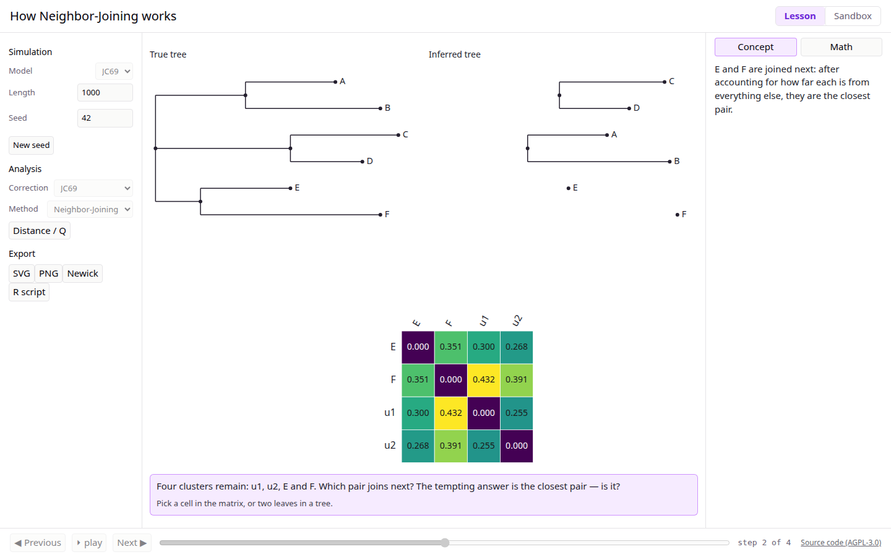

# NeoPhylo

Learn how phylogenetic trees are built — step by step, in your browser.

**Try it:** https://neophylo.netlify.app

## Who it's for

Students and instructors in introductory phylogenetics, biochemistry and
evolution courses — anyone who wants to _see_ what Neighbor-Joining and UPGMA
do to a distance matrix, one join at a time, instead of treating the tree
builder as a black box.

## Features

- **Step-through tree building.** Neighbor-Joining and UPGMA, one join at a
  time. Every panel — true tree, inferred tree, distance/Q matrix — stays in
  sync with the stepper.
- **Distance models.** p-distance, JC69 and K80, with saturated cells shown as
  "cannot estimate" teaching states rather than silent failures.
- **Simulation on a true tree.** DNA sequences evolve along a known tree under
  JC69 or K80, so the inferred tree can always be compared against the truth
  (Robinson–Foulds distance shown at the last step).
- **Guided lessons.** Built-in exercises pause at key joins with
  predict-then-reveal prompts and can lock controls so students change only
  the intended levers.
- **Sandbox.** Import your own FASTA alignment or Newick tree and run the same
  pipeline on it.
- **Shareable links.** The full state — lesson, overrides, current step — is
  encoded in the URL; custom exercises travel in the fragment and are never
  sent to a server.
- **Export.** Tree as SVG, PNG or Newick, plus a runnable R script that
  reproduces the analysis with `ape`/`phangorn`.
- **Offline and accessible.** Works offline after first load; full keyboard
  operation, colorblind-safe palette, axe checks in CI.

## How we know it's correct

- **Verified against reference implementations.** The engine's distances,
  branch lengths and topologies are checked against R (`ape`/`phangorn`) to
  10⁻⁹, and against PHYLIP to its printed precision, on a committed fixture
  corpus (`fixtures/`).
- **Property tests.** `proptest` verifies invariants on random inputs: NJ
  recovers any additive matrix, UPGMA recovers any ultrametric matrix, Newick
  round-trips, and more.
- **Fuzzing.** The parsers are fuzzed with `cargo-fuzz`; the engine must never
  panic on any input.
- **Determinism.** Seeded ChaCha RNG and `libm` math give bit-identical
  results on native and wasm builds, so shared links always show the same
  simulation.

See [docs/architecture.md](docs/architecture.md) for the design and
[the spec §8](docs/superpowers/specs/2026-10-15-neophylo-design.md#8-testing-and-validation)
for the full testing strategy.

## For instructors

- **Built-in lessons** live in [`exercises/`](exercises/) —
  [`nj-basics.json`](exercises/nj-basics.json) (how NJ works),
  [`upgma-fails.json`](exercises/upgma-fails.json) (when the molecular clock
  breaks UPGMA) and [`saturation.json`](exercises/saturation.json)
  (distance corrections).
- **Author your own** as a JSON file: a true tree, a simulation spec, an
  analysis spec, optional locked fields and step-anchored prompts. The format
  is documented in [`exercises/schema.json`](exercises/schema.json); copy
  `nj-basics.json` as a starting point. A custom exercise can be shared with
  students as a single URL.

## Development

- **Prerequisites:** `bash setup-ubuntu.sh` on Ubuntu 22.04/24.04 installs
  everything (Rust stable + wasm target + nightly, Node via nvm, R + ape /
  phangorn, PHYLIP, wasm-pack, cargo-fuzz).
- **Checks:** `./scripts/check.sh` runs the whole suite — it must pass before
  every commit. Optional gates: `E2E=1` (Playwright), `RPARITY=1` (R export
  parity), `FUZZ=1` (fuzz smoke run), `FIXTURES=1` (regenerate fixtures —
  human only).
- **Layout:** the Rust engine lives in `crates/neophylo-core` (all the
  science), `crates/neophylo-wasm` is a thin bindings layer, `web/` is a
  React 19 + TypeScript + Vite app, `exercises/` holds lesson JSON and
  `fixtures/` the reference corpus.
- **How it's built:** spec → plan → one task per branch. The design spec and
  task plan are in [`docs/superpowers/`](docs/superpowers/); the working
  rules are in [`AGENTS.md`](AGENTS.md) and decisions/deviations are logged
  in [`docs/decisions.md`](docs/decisions.md).
- **Deploys:** every push to `main` deploys to staging at
  `main--<site>.netlify.app` (URL also printed in the CI job summary);
  production updates only on version tags `v*.*.*` or the manual
  "Deploy production" workflow run — each production deploy costs Netlify
  credits, so plain pushes never trigger one. Same-repo PRs get free
  `pr-<n>` previews.
- **Docs media:** the screenshot and GIF above are regenerated with
  `web/scripts/record-media.mjs` (Playwright video → ffmpeg → GIF).

## Citing

If you use NeoPhylo in teaching or research, please cite it — see
[`CITATION.cff`](CITATION.cff).

## License

[AGPL-3.0-only](LICENSE). The hosted app links back to this source code from
its footer, as the license requires.

## Contributing

See [`CONTRIBUTING.md`](CONTRIBUTING.md). Contributors sign a CLA (see
[`CLA.md`](CLA.md)) via CLA Assistant on their first pull request.
