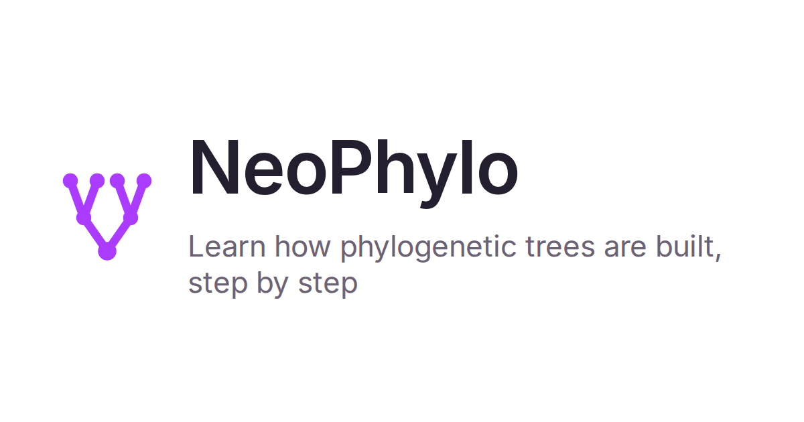
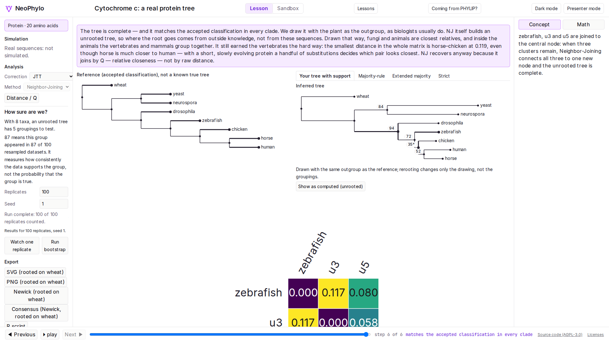
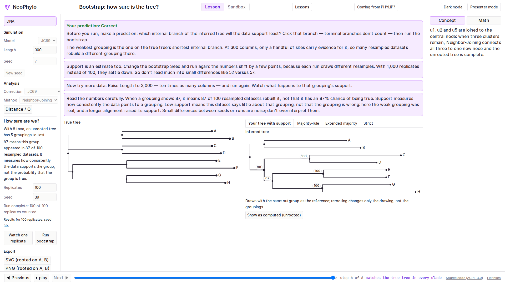

# NeoPhylo



Learn how phylogenetic trees are built — step by step, in your browser.

[](https://github.com/dorrabbkhan/NeoPhylo/actions/workflows/ci.yml)
[](LICENSE)
[](https://neophylo.netlify.app)





**Try it:** https://neophylo.netlify.app

## Who it's for

Students and instructors in introductory phylogenetics, biochemistry and
evolution courses — anyone who wants to _see_ what Neighbor-Joining and UPGMA
do to a distance matrix, one join at a time, instead of treating the tree
builder as a black box.

## Features

- **Step-through tree building.** Neighbor-Joining and UPGMA, one join at a
  time. Every panel — true tree, inferred tree, distance/Q matrix — stays in
  sync with the stepper.
- **Distance models.** DNA: p-distance, JC69 and K80. Protein: p-distance,
  the Kimura correction and JTT maximum likelihood — with saturated cells
  shown as "cannot estimate" teaching states rather than silent failures.
- **Bootstrap, made visible.** `seqboot`-style column resampling (10–1,000
  replicates) runs in a background worker with live progress, an ETA and
  cancel. Support lands on the tree itself; strict, majority-rule and
  extended-majority consensus sit one tab away, and "watch one replicate"
  shows exactly which columns a resample drew.
- **"How was this distance computed?"** Click any pair in a protein matrix
  to see the two sequences aligned with every difference marked, p, Kimura
  and JTT side by side, and the likelihood curve showing how JTT picks the
  distance that makes the sequences most probable.
- **Simulation on a true tree.** DNA or protein sequences evolve along a
  known tree under JC69, K80 or JTT, so the inferred tree can always be
  compared against the truth (Robinson–Foulds distance shown at the last
  step).
- **Guided lessons.** Built-in exercises pause at key joins with
  predict-then-reveal prompts and can lock controls so students change only
  the intended levers.
- **Sandbox.** Import your own FASTA or PHYLIP alignment — DNA or protein,
  auto-detected — or a Newick tree, and run the same pipeline on it. JTT on
  a 200×1,000 protein alignment computes in about two seconds on a typical
  laptop.
- **Shareable links.** The full state — lesson, overrides, current step — is
  encoded in the URL; custom exercises travel in the fragment and are never
  sent to a server.
- **Export.** Tree as SVG, PNG or Newick (with bootstrap support as internal
  labels), the current consensus tree as Newick, a PHYLIP square distance
  matrix ready for `neighbor`, and a runnable R script that reproduces the
  analysis — bootstrap included — with `ape`/`phangorn`.
- **Offline and accessible.** Works offline after first load; full keyboard
  operation, colorblind-safe palette, axe checks in CI.

## Current scope

NeoPhylo covers distance-based tree building (distances, NJ, UPGMA) with
bootstrap support, consensus trees and reference-style rooting. Not yet:
sequence alignment, parsimony or likelihood tree search. These are on the
[roadmap](docs/roadmap.md). It is a teaching
tool; for research analyses use dedicated software such as IQ-TREE or
RAxML-NG.

## Coming from PHYLIP?

Paste a `.phy` alignment straight into the Sandbox — Strict (10-char) and
Relaxed names are handled, and the in-app "Coming from PHYLIP?" help maps
`protdist` models to NeoPhylo corrections. Export the distance matrix in
`neighbor` input format and cross-check against R with
[`scripts/compare/compare_app.R`](scripts/compare/compare_app.R):

```sh
Rscript scripts/compare/compare_app.R <alignment> <matrix> <model>
```

- `<alignment>`: a FASTA or PHYLIP-sequential alignment file.
- `<matrix>`: the app's "PHYLIP matrix (for neighbor)" export (Strict or
  Relaxed names are auto-detected).
- `<model>`: `p`, `JC69` or `K80` for DNA; `p`, `Kimura` or `JTT` for
  protein (the alphabet is detected from the alignment).

NeoPhylo's JTT reproduces `protdist`'s default model to PHYLIP's printed
precision (including the documentation's own test example), and its
exported matrices produce identical trees in `neighbor`. The
`seqboot` → `neighbor` → `consense` lab runs end to end: bootstrap counts
and strict, majority-rule and extended-majority consensus match `consense`
and `ape::prop.clades` exactly on the fixture tree sets.

## How we know it's correct

- **Verified against reference implementations.** DNA distances, branch
  lengths and topologies match R (`ape`/`phangorn`) to 10⁻⁹ and PHYLIP to
  its printed precision. Protein distances match PHYLIP `protdist` (JTT,
  Kimura) to its printed precision, including PHYLIP's published test
  example. Bootstrap counts and consensus trees match PHYLIP `consense` and
  `ape::prop.clades` exactly, and support values track `ape::boot.phylo`
  within 5 percentage points over 1,000 replicates. All on a committed
  fixture corpus (`fixtures/`).
- **Property tests.** `proptest` verifies invariants on random inputs: NJ
  recovers any additive matrix, UPGMA recovers any ultrametric matrix, Newick
  round-trips, and more.
- **Fuzzing.** The parsers are fuzzed with `cargo-fuzz`; the engine must never
  panic on any input.
- **Determinism.** Seeded ChaCha RNG and `libm` math give bit-identical
  results on native and wasm builds, so shared links always show the same
  simulation.

See [docs/architecture.md](docs/architecture.md) for the design and
[the spec §8](docs/superpowers/specs/2026-10-15-neophylo-design.md#8-testing-and-validation)
for the full testing strategy.

## For instructors

- **Built-in lessons** (pick them from the Lessons menu, or link directly
  with `?lesson=<id>`):
  - [`nj-basics`](exercises/nj-basics.json): how Neighbor-Joining works
  - [`upgma-fails`](exercises/upgma-fails.json): when the molecular clock
    breaks UPGMA
  - [`saturation`](exercises/saturation.json): why distance corrections
    matter
  - [`bootstrap-basics`](exercises/bootstrap-basics.json): how sure are we?
    (support, resampling, consensus)
  - [`protein-models`](exercises/protein-models.json): when counting
    differences isn't enough (p vs JTT)
  - [`cytochrome-c`](exercises/cytochrome-c.json): a real protein tree from
    UniProt, compared with the accepted classification
- **Author your own** as a JSON file: choose DNA or protein, either a true
  tree plus simulation settings or your own aligned sequences (embedded
  FASTA, with source and license), a reference tree (a known true tree, or
  an accepted classification for real data), the analysis settings,
  optional locked controls, and step-anchored prompts. The format is
  documented in [`exercises/schema.json`](exercises/schema.json); copy
  `nj-basics.json` (simulated) or `cytochrome-c.json` (real data) as a
  starting point.

## Development

- **Prerequisites:** `bash setup-ubuntu.sh` on Ubuntu 22.04/24.04 installs
  everything (Rust stable + wasm target + nightly, Node via nvm, R + ape /
  phangorn, PHYLIP, wasm-pack, cargo-fuzz).
- **Checks:** `./scripts/check.sh` runs the whole suite — it must pass before
  every commit. Optional gates: `E2E=1` (Playwright), `RPARITY=1` (R export
  parity), `FUZZ=1` (fuzz smoke run), `FIXTURES=1` (regenerate fixtures —
  human only).
- **Layout:** the Rust engine lives in `crates/neophylo-core` (all the
  science), `crates/neophylo-wasm` is a thin bindings layer, `web/` is a
  React 19 + TypeScript + Vite app, `exercises/` holds lesson JSON and
  `fixtures/` the reference corpus.
- **How it's built:** spec → plan → one task per branch. The design spec and
  task plan are in [`docs/superpowers/`](docs/superpowers/); the working
  rules are in [`AGENTS.md`](AGENTS.md) and decisions/deviations are logged
  in [`docs/decisions.md`](docs/decisions.md).
- **Deploys:** `main` deploys to staging; production updates on version
  tags.
- **Docs media:** the screenshot and GIF above are regenerated with
  `web/scripts/record-media.mjs` (Playwright video → ffmpeg → GIF).

## Citing

If you use NeoPhylo in teaching or research, please cite it — see
[`CITATION.cff`](CITATION.cff).

## License

[AGPL-3.0-only](LICENSE). The hosted app links back to this source code from
its footer, as the license requires. JTT model data comes from PHYLIP
(BSD-2-Clause) and the cytochrome c lesson uses UniProtKB data (CC BY 4.0);
see [`THIRD_PARTY_NOTICES.md`](THIRD_PARTY_NOTICES.md).

## Contributing

See [`CONTRIBUTING.md`](CONTRIBUTING.md). Contributors sign a CLA (see
[`CLA.md`](CLA.md)) via CLA Assistant on their first pull request.
