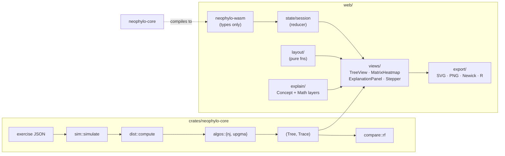

# Architecture

NeoPhylo is a Cargo workspace (a pure-Rust engine plus a thin wasm-bindgen
layer) and a static React web app. All the science lives in the engine; the
browser only renders, routes state and drives the stepper. The design
authority is
[`docs/superpowers/specs/2026-10-15-neophylo-design.md`](superpowers/specs/2026-10-15-neophylo-design.md);
this document is the orientation map.

## Units

### `crates/neophylo-core` — the engine

Pure Rust, no wasm, UI or clock dependencies. Every function is deterministic
for a given input and seed, and the crate must never panic on any input —
parsing and runtime failures are `NeoError` values.

- **`seq`** — DNA alignments. Case-insensitive input, `U` → `T`, IUPAC
  ambiguity codes and `-`/`?` accepted on import. Missing data uses pairwise
  deletion; a pair with zero comparable sites is `InsufficientOverlap`.
  Limits: 200 taxa, 100,000 sites.
- **`sim`** — sequence evolution along a true tree under JC69 or K80{κ},
  driven by a seeded `ChaCha8Rng` with a fixed consumption order (root
  sequence first, then branches in preorder, one uniform draw per site per
  branch). Output is a tip alignment.
- **`dist`** — p, JC69 and K80 distance corrections. Each matrix cell is a
  value or `Saturated`; the matrix is symmetric with a zero diagonal.
- **`tree` / `newick`** — a node arena addressed by `NodeId`, with branch
  attributes stored separately keyed by the *child* node so rerooting cannot
  misplace them. The Newick parser supports quoted labels, lengths, internal
  labels and comments; writing is lossless for labels and lengths.
- **`algos`** — Neighbor-Joining and UPGMA, each returning `(Tree, Trace)`.
  Both refuse matrices containing `Saturated` cells. The trace records every
  join — active clusters, the matrix, R/Q values, the chosen pair, tie flag
  and branch lengths — so the UI can replay any step without recomputing.
- **`compare`** — unrooted Robinson–Foulds distance over bipartitions, used
  for both NJ and UPGMA output.
- **`exercise` / `error`** — the exercise file model plus `NeoError`, a
  single serializable enum covering every failure mode (`Parse`,
  `UnequalLengths`, `SaturatedMatrix`, `LabelMismatch`, …).

### `crates/neophylo-wasm` — the boundary

Type conversion only, no logic. `serde` + `serde-wasm-bindgen` cross the
boundary; TypeScript types are generated from the Rust structs with `ts-rs`
into `web/src/engine/generated/` (never hand-edited). The wasm build is
single-threaded — no `SharedArrayBuffer`, so any static host works — and
stays under 1 MB gzipped.

### `web/` — the app

React 19 + TypeScript strict + Vite; KaTeX for formulas, SVG for all
rendering, `vite-plugin-pwa` for offline use.

- **`src/engine`** — the wasm session wrapper: it exposes the exported
  functions (`simulate`, `parse_fasta`, `distances`, `build_tree`,
  `compare`, …) behind typed wrappers, with a `Session` built by
  `state/session.ts` around them. No engine math is duplicated in
  TypeScript.
- **`src/layout`** — pure functions that turn a `Tree` into phylogram /
  cladogram coordinates. Unit-tested, shared by on-screen SVG and export.
- **`src/views`** — the components: `TreeView`, `MatrixHeatmap` (distance or
  Q, WAI-ARIA grid), `ExplanationPanel`, `Stepper`, `PromptCard`,
  `TeachingNotices` (saturated cells, negative lengths, ties), `ImportPanel`,
  `ExportMenu`, `ErrorBoundary`.
- **`src/explain`** — the Concept (plain language) and Math (KaTeX with the
  step's live values) explanation layers, both rendered from the same trace
  record.
- **`src/lessons`** — lesson loading and validation (ajv against
  `exercises/schema.json`), prompt gating, and the embedded default lesson.
- **`src/state`** — the session reducer plus URL state: `?lesson=<id>` with
  overrides for built-ins, compressed JSON in `#x=` for custom exercises;
  the current step and Concept/Math mode are encoded too, and
  `schema_version` governs migration on load.
- **`src/export`** — SVG, PNG (rasterized from the SVG), Newick and an R
  script (`ape::dist.dna` + `ape::nj`/`phangorn::upgma`) checked for parity
  in CI.

### `exercises/` and `fixtures/`

`exercises/` holds the built-in lesson JSON files, validated against
`schema.json`. `fixtures/` is the reference corpus: inputs plus outputs
generated by `generate.R` (ape/phangorn) and `generate_phylip.sh` (dnadist /
neighbor), plus hand-checked step-level worked examples. Fixtures are the
oracle — they are never edited by hand and never change in the same commit
as engine code (CI's fixture-guard enforces this).

## Determinism rules

Shared links embed a seed and replay the whole pipeline, so results must be
reproducible bit-for-bit across machines and targets:

- **`libm` for all math.** `exp`, `ln`, `pow` in `neophylo-core` go through
  the `libm` crate, never the `f64` methods — clippy denies the float
  methods outright. This makes native and wasm builds produce identical
  floating-point results.
- **Seeded `ChaCha8Rng`, fixed consumption order.** The simulator draws the
  root sequence first (sites in order), then visits branches in preorder
  with one uniform draw per site per branch, and orders outcomes
  deterministically. No `Math.random` or unseeded RNG anywhere; golden
  hashes of seeded alignments are committed so any drift is a breaking
  change.
- **Node-ID conventions.** Tree nodes live in an arena: leaves are
  `NodeId(0..n)` in input order and internal nodes are numbered in creation
  order; the UI names them u1, u2, … likewise. Algorithm traces index
  active clusters the same way, with ties broken by lowest `(i, j)`
  lexicographically — so a trace from any build replays identically.
- **No ambient dependencies.** The engine never reads the clock, the
  environment or thread-local state, and runs single-threaded on the main
  thread.

## Testing layers

From closest to the metal to closest to the user (spec §8):

1. **Reference corpus** — committed fixtures generated by R (ape/phangorn)
   and PHYLIP: distances and branch lengths to 10⁻⁹, NJ topology exact,
   UPGMA checked by rooted clades and heights. PHYLIP's K80 uses a
   fixed-ratio estimator, so its known divergence from §4.3 K80 is asserted
   rather than equality; CI regenerates the corpus and fails on drift.
2. **Step-level worked examples** — textbook NJ and UPGMA traces verified
   per join (every R, Q, chosen pair, branch length, new row).
3. **Property tests (`proptest`)** — NJ recovers additive matrices, UPGMA
   recovers ultrametric ones, distance matrices stay symmetric, Newick
   round-trips, RF is symmetric and RF(t,t)=0.
4. **Simulator checks** — convergence at 100,000 sites (corrected distance
   within 2% of true path length) plus committed golden hashes of seeded
   alignments.
5. **Native vs. wasm parity** — corpus subset and golden hashes rerun under
   `wasm-pack test --node`; output must be bit-identical.
6. **Export parity** — CI executes the generated R scripts and compares
   their output to the engine's.
7. **Web tests** — Vitest for layout, state, explanation numbers and
   components; Playwright drives a full guided lesson and a share-link
   round trip on Chromium, Firefox and WebKit; axe checks accessibility.
8. **Fuzzing** — `cargo-fuzz` over the parsers; a panic anywhere is a bug.

`./scripts/check.sh` runs all of this locally; `.github/workflows/ci.yml`
runs the same `scripts/ci/*.sh` steps on every push and PR.
